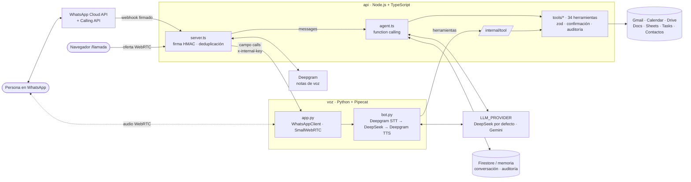

# Camaleón

Asistente por **WhatsApp** (chat, notas de voz y llamadas) que maneja el **Google Workspace** de una persona o una pyme con lenguaje natural: **Gmail, Calendar, Drive, Docs, Sheets, Tasks y Contactos**. El cerebro es intercambiable con `LLM_PROVIDER`: **DeepSeek** (por defecto, SDK `openai`) o **Gemini** (`@google/genai`), siempre con function calling y las mismas herramientas.

Ejemplos de lo que puedes decirle:

- *"¿Cómo va mi día?"*: agenda de hoy y mañana, correos sin leer y tareas pendientes.
- *"¿Qué me escribió Freddy?"*, *"léeme ese correo"*, *"respóndele que mañana le mando el video"*, *"envíale a Ana la propuesta con copia a Pedro"*.
- *"¿Estoy libre el viernes en la tarde?"*, *"agenda una reunión con Freddy el lunes a las 10 con Meet"*, *"muévela para las 11"*, *"cancela la de mañana"*.
- *"Busca en Drive la propuesta y resúmemela"*, *"compártela con freddy@ejemplo.com como editor"*, *"crea una carpeta Clientes 2026"*.
- *"Créame un Sheets llamado Presupuesto"*, *"cambia B3 a 60.000"*, *"hazme un Doc con el acta de hoy"*, *"agrégale estos puntos"*.
- *"Recuérdame enviar la factura el viernes"* (Google Tasks) y *"¿cuál es el correo de Alena?"* (Contactos).
- 📎 Un archivo adjunto: lo guarda en Drive y puede leerlo.
- 🎤 Una **nota de voz** con cualquiera de esas frases: la transcribe con Deepgram (nova-3), la atiende y responde con texto y voz (Deepgram aura-2).
- 📞 Una **llamada de WhatsApp** o desde el navegador: conversa en tiempo real (servicio `voz/`, Pipecat: Deepgram → DeepSeek → Deepgram) con las mismas herramientas.

Toda acción que escribe o envía (correos, eventos, archivos, filas, tareas, permisos) **pide un "sí"** antes de ejecutarse, y todo queda en un **registro de auditoría**.

Prototipo para la prueba técnica de StartinLab, hecho por Daniel Fajardo.

## Arquitectura



- **api** (`src/`) recibe el webhook de Meta: los mensajes de texto, archivos y notas de voz los atiende el agente; los avisos de **llamadas** (campo `calls`) los reenvía a `voz`.
- **voz** (`voz/`) contesta la llamada por WebRTC y conversa. No duplica lógica: pide y ejecuta las herramientas en la api (`/internal/tools` y `/internal/tool`).

| App | Herramienta | Qué hace | Confirmación |
|---|---|---|---|
| — | `resumen_dia` | Agenda de hoy y mañana, correos sin leer y tareas pendientes | No |
| Gmail | `gmail_buscar` / `gmail_leer` | Busca con sintaxis de Gmail y lee el correo completo | No |
| Gmail | `gmail_enviar` | Envía un correo (con copia opcional) | **Sí** |
| Gmail | `gmail_responder` | Responde al remitente dentro del mismo hilo | **Sí** |
| Gmail | `gmail_borrador` | Deja un borrador para que la persona lo envíe | **Sí** |
| Gmail | `gmail_eliminar` / `gmail_archivar` / `gmail_spam` | Papelera, archivo o spam, por ids o por búsqueda (hasta 50) | **Sí** |
| Gmail | `gmail_marcar` / `gmail_etiquetar` | Leído o no leído; etiquetas (la crea si no existe) | No / **Sí** |
| Gmail | `gmail_bloquear` / `gmail_desbloquear` | Filtro que manda a la papelera todo lo de un remitente | **Sí** |
| Calendar | `calendar_listar` / `calendar_disponibilidad` | Agenda por rango o texto; huecos libres de un día | No |
| Calendar | `calendar_crear` | Evento con hora o de día completo, invitados, Google Meet y repetición | **Sí** |
| Calendar | `calendar_modificar` / `calendar_eliminar` | Mover, cambiar, invitar más gente o cancelar | **Sí** |
| Calendar | `calendar_responder` | Aceptar, rechazar o "tal vez" a una invitación | **Sí** |
| Drive | `drive_buscar` / `drive_leer` | Busca archivos y lee Docs, Sheets, Slides, PDF o texto | No |
| Drive | `drive_guardar_adjunto` | Guarda el archivo enviado por WhatsApp | No¹ |
| Drive | `drive_crear_carpeta` / `drive_compartir` | Carpetas y permisos (lector, comentador, editor) | **Sí** |
| Docs | `docs_crear` / `docs_agregar_texto` | Crea un Doc o agrega texto al final | **Sí** |
| Sheets | `sheets_leer` | Lee celdas | No |
| Sheets | `sheets_crear` / `sheets_agregar_fila` / `sheets_actualizar` | Crea hojas, agrega filas y escribe celdas o fórmulas | **Sí** |
| Tasks | `tareas_listar` | Tareas pendientes | No |
| Tasks | `tareas_crear` / `tareas_completar` | Crea y completa tareas | **Sí** |
| Contactos | `contactos_buscar` | Correo y teléfono de una persona | No |

¹ La persona ya mostró su intención al enviar el archivo.

Por voz están todas menos `drive_guardar_adjunto`.

## 1. Ejecución local

Necesitas Node.js 22 o superior. Para las llamadas, también Docker o Python 3.13.

### Sin credenciales: demo, pruebas y typecheck

```bash
npm install
npm test          # 59 pruebas con el LLM (cliente openai simulado) y Workspace simulados, sin red
npm run demo      # conversación simulada por consola (correo, agenda, Drive, tareas, nota de voz)
npm run lint      # tsc --noEmit
npm run probar    # prueba REAL del cerebro (DeepSeek) con Workspace simulado; usa DEEPSEEK_API_KEY de .env
```

### Con WhatsApp real

1. **`.env`**: copia `.env.example` a `.env` y llénalo. En este equipo ya vienen llenas `DEEPSEEK_API_KEY`, `DEEPGRAM_API_KEY`, las `WHATSAPP_*`, `VOICE_INTERNAL_KEY` y `LLAMADA_TOKEN`. Para probar el cerebro sin WhatsApp: `npm run probar` (DeepSeek real con Workspace simulado).
2. **Google OAuth** (para usar tu propio Drive, Sheets, Calendar y Gmail):
   - En Google Cloud Console habilita las APIs de Drive, Docs, Sheets, Calendar, Gmail, Tasks y People.
   - Configura la pantalla de consentimiento en modo *Testing* y agrégate como usuario de prueba.
   - Crea un **ID de cliente OAuth** de tipo *App de escritorio*. Pon su id y su secreto en `.env`.
   - Ejecuta `npm run oauth`: abre el enlace, autoriza y el refresh token queda guardado en `.env` sin mostrarse.
3. **Arranca la api y expónla:**
   ```bash
   npm run dev              # http://localhost:8080 (recarga al guardar, lee .env)
   ngrok http 8080          # en otra terminal: usa la URL https que te da
   ```
4. En Meta, configura el webhook con `https://<ngrok>/webhook` y suscribe `messages` (más detalles abajo). Escríbele al número desde `WHATSAPP_TEST_NUMBER`.

### Llamadas (api + voz)

```bash
docker compose up --build        # api en :8080 y voz en :7860
ngrok http 8080
```

- **Llamada desde el navegador**: abre `http://localhost:8080/llamada?token=<LLAMADA_TOKEN>` y toca **Hablar**.
- **Llamada de WhatsApp**: sigue [docs/LLAMADAS.md](docs/LLAMADAS.md). Allí está cómo activar el calling en el número y suscribir el campo `calls`.

Si WebRTC no conecta dentro de Docker (por ejemplo en Mac o Windows), corre `voz` directo con Python mientras la api sigue con `npm run dev`:

```bash
cd voz && python -m venv .venv && . .venv/bin/activate && pip install -r requirements.txt
uvicorn app:app --port 7860      # lee ../.env
```

## 2. Producción en 1 comando

```bash
gcloud auth login && gcloud config set project <tu-proyecto>
./deploy.sh                      # VOZ_DESTINO=run ./deploy.sh para poner voz en Cloud Run
```

`deploy.sh`:

- habilita las APIs, crea la cuenta de servicio `camaleon`, Firestore y Artifact Registry;
- sube a **Secret Manager** los secretos de `.env`, sin mostrarlos;
- despliega la **api en Cloud Run** con `ALMACEN=firestore` y `--no-cpu-throttling`;
- despliega **voz**:
  - por defecto, en una **VM de Compute Engine** con Docker en `--network host`, UDP abierto para WebRTC y el puerto 7860 accesible solo por la red privada (Direct VPC egress);
  - con `VOZ_DESTINO=run`, en Cloud Run, que no acepta UDP entrante y puede fallar (ver la tabla en docs/LLAMADAS.md);
- al terminar imprime la URL del webhook y la de `/llamada`.

## Variables de entorno

Las valida `src/config.ts` con zod al arrancar. La lista completa con comentarios está en `.env.example`.

| Grupo | Variables |
|---|---|
| Cerebro | `LLM_PROVIDER` (deepseek \| gemini), `DEEPSEEK_API_KEY` 🔒, `DEEPSEEK_MODEL` (deepseek-chat), `DEEPSEEK_BASE_URL` |
| Deepgram | `DEEPGRAM_API_KEY` 🔒, `DEEPGRAM_STT_MODEL` (nova-3), `DEEPGRAM_TTS_VOZ` (aura-2-celeste-es) |
| Gemini (alternativa) | `GEMINI_API_KEY` 🔒, `GEMINI_MODEL` (gemini-3.8-flash), `GEMINI_LIVE_MODEL` (gemini-3.8-live), `GEMINI_TTS_MODEL` (gemini-3.8-flash-tts), `GEMINI_VOZ`, `RESPONDER_CON_VOZ` |
| WhatsApp | `WHATSAPP_ACCESS_TOKEN` 🔒, `WHATSAPP_PHONE_NUMBER_ID`, `WHATSAPP_VERIFY_TOKEN` 🔒, `WHATSAPP_APP_SECRET` 🔒, `WHATSAPP_API_VERSION`, `WHATSAPP_BUSINESS_ACCOUNT_ID`, `WHATSAPP_TEST_NUMBER`, `WHATSAPP_NUMEROS_PERMITIDOS` |
| Voz | `VOZ_URL`, `BACKEND_URL`, `VOICE_INTERNAL_KEY` 🔒, `LLAMADA_TOKEN` 🔒 |
| Google | `GOOGLE_OAUTH_CLIENT_ID`, `GOOGLE_OAUTH_CLIENT_SECRET` 🔒, `GOOGLE_OAUTH_REFRESH_TOKEN` 🔒, `DRIVE_CARPETA_ID`, `CALENDAR_ID` |
| Estado | `ALMACEN` (memoria \| firestore), `FIRESTORE_COLECCION`, `PORT`, `ZONA_HORARIA` |

## Webhook en Meta

En [Meta for Developers](https://developers.facebook.com/), entra a tu app y luego a *WhatsApp > Configuración > Webhook*:

1. URL: `https://<ngrok o Cloud Run>/webhook`. Token de verificación: el valor de `WHATSAPP_VERIFY_TOKEN`. Pulsa *Verificar y guardar*.
2. Suscribe los campos **`messages`** y **`calls`**. Para que `calls` funcione, antes hay que activar las llamadas en el número (ver docs/LLAMADAS.md).

## Qué necesita cada cosa

| Funciona… | Requisitos |
|---|---|
| `npm test`, `npm run demo`, `npm run lint`, `npm run build` | Nada: sin key, sin red, sin credenciales |
| Arrancar la api (`npm run dev`), chat con herramientas, lectura de PDF con texto | `DEEPSEEK_API_KEY` (ya está) y las variables de WhatsApp (ya están). Con `LLM_PROVIDER=gemini`, `GEMINI_API_KEY` con saldo |
| Notas de voz (transcribir y responder con voz) y llamadas | `DEEPGRAM_API_KEY` (ya está). Con Gemini: su key, más `ffmpeg` para la voz de respuesta (incluido en la imagen Docker) |
| Drive, Sheets, Docs, Calendar y Gmail reales | OAuth de Google (`npm run oauth`). En Cloud Run sin OAuth se usa la cuenta de servicio, pero sin Gmail ni tu Drive personal |
| Llamadas por WhatsApp | Lo anterior, el servicio `voz` corriendo y que Daniel active el calling en el número y suscriba `calls` |

## Seguridad

- **Firma del webhook**: se verifica `X-Hub-Signature-256` (HMAC-SHA256 del cuerpo crudo con el app secret, en tiempo constante) antes de parsear. Para llamadas, `voz` la vuelve a verificar con `WhatsAppClient`.
- **Lista blanca**: se usa `WHATSAPP_NUMEROS_PERMITIDOS` o, si está vacía, `WHATSAPP_TEST_NUMBER`. Aplica al chat, a las llamadas (el bot cuelga) y a `/internal/tool`. Sin lista blanca, la api avisa en los logs, porque cualquiera podría usar tu Workspace.
- **Confirmación humana** en toda escritura:
  - En el chat, con un "sí" que interpreta el backend.
  - En voz, con un código de un solo uso que ejecuta exactamente la acción preguntada.
  - Gmail nunca envía.
  - Esto también mitiga la *prompt injection* desde documentos o correos.
- **Auditoría**: cada herramienta, con error o cancelada, queda en Firestore (`auditoria`) con quién, qué, argumentos y resultado.
- **Secretos** solo por variables de entorno: `.env` (en `.gitignore`, permisos 600) en local y Secret Manager en producción. La comunicación entre api y voz usa `x-internal-key`; en producción va por la red privada.
- **Validación**: los argumentos del modelo se validan con zod. La vigencia de los documentos se comprueba con una regla en el código.
- **Datos personales** (Ley 1581 de 2012): los archivos van solo a Drive. El historial no guarda binarios y se recorta.

## Limitaciones

- Maneja una sola cuenta de Google por despliegue (la del OAuth). Las conversaciones simultáneas del mismo usuario no se bloquean entre sí.
- El webhook se procesa en segundo plano dentro de la instancia. Para producción convendría usar Cloud Tasks.
- En voz, que el modelo espere el "sí" depende del prompt. El código impide cambiar la acción, pero no impide que el modelo la confirme solo.
- El modo *Testing* de OAuth vence el refresh token cada 7 días. Para uso continuo hay que publicar la app de OAuth o verificarla, porque Gmail usa scopes restringidos.
- Con DeepSeek (solo texto), los PDF escaneados o las fotos no se pueden leer; con Gemini sí.
- Los nombres de modelo se cambian por variables de entorno (`DEEPSEEK_MODEL`, `GEMINI_MODEL`…).
- Las llamadas de WhatsApp no se probaron de punta a punta en este entorno porque falta activar el calling.

## Siguientes pasos

1. Varias cuentas de Google: OAuth por usuario de WhatsApp, con tokens cifrados en Firestore.
2. Botones interactivos de WhatsApp para confirmar, y plantillas aprobadas para avisos proactivos (resumen del día a las 7 a. m., recordatorio 10 minutos antes de cada reunión).
3. Gmail avanzado: archivar, etiquetar y adjuntar archivos de Drive a los correos (scope `gmail.modify`).
4. Cloud Tasks y transacciones de Firestore por usuario.
5. Guardar la transcripción de las llamadas en el historial del chat, para que WhatsApp y la voz compartan memoria.
