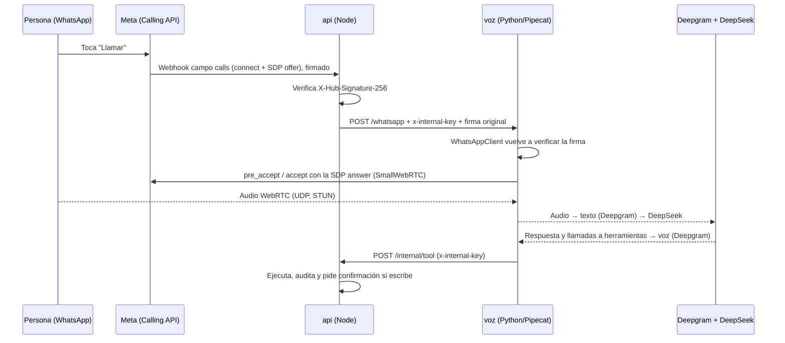

# Llamadas de WhatsApp con Camaleón

Con este flujo puedes llamar al número de WhatsApp del asistente y hablarle como a una persona. El asistente contesta con Deepgram STT → DeepSeek → Deepgram TTS (o Gemini Live con `LLM_PROVIDER=gemini`) y maneja tu Google Workspace con las mismas herramientas del chat.



## 1. Requisitos

- El número debe estar en la **Cloud API**, no en la app WhatsApp Business.
- Tu número de negocio necesita un límite de mensajería de al menos **2.000 destinatarios únicos por día**. Los números de prueba públicos no tienen ese requisito, pero traen las llamadas **desactivadas**.
- La app de Meta necesita el permiso `whatsapp_business_messaging` y estar suscrita a la cuenta de WhatsApp Business.
- El servicio `voz` debe estar corriendo con salida UDP a internet. En local sirve tu PC; en producción, la VM que crea `deploy.sh`.
- La api debe recibir el webhook por una URL pública: ngrok en local o la URL de Cloud Run.

## 2. Activar las llamadas en el número

> ⚠️ **Este paso lo hace Daniel.** El prototipo no lo ejecuta.

```bash
set -a; source .env; set +a
curl -X POST "https://graph.facebook.com/$WHATSAPP_API_VERSION/$WHATSAPP_PHONE_NUMBER_ID/settings" \
  -H "Authorization: Bearer $WHATSAPP_ACCESS_TOKEN" \
  -H "Content-Type: application/json" \
  -d '{"calling":{"status":"ENABLED"}}'

# Verificar
curl "https://graph.facebook.com/$WHATSAPP_API_VERSION/$WHATSAPP_PHONE_NUMBER_ID/settings" \
  -H "Authorization: Bearer $WHATSAPP_ACCESS_TOKEN"
```

Para apagarlas, envía el mismo POST con `"status":"DISABLED"`.

## 3. Suscribir el campo `calls` en el webhook

En Meta for Developers, abre tu app y entra a *WhatsApp > Configuración > Webhook*:

1. La URL de devolución de llamada debe ser la de la api: `https://<ngrok o Cloud Run>/webhook`.
2. En *Campos del webhook*, suscribe **`messages`** (chat y notas de voz) y **`calls`** (llamadas).

La api reenvía al servicio `voz` solo los avisos que traen `calls`. Los demás los procesa ella misma.

## 4. Probar

1. Levanta todo:
   - En local: `docker compose up --build` y `ngrok http 8080`.
   - En producción: `./deploy.sh`.
2. Desde el número autorizado (`WHATSAPP_TEST_NUMBER` o `WHATSAPP_NUMEROS_PERMITIDOS`), abre el chat con el número del negocio y toca **Llamar**.
3. Debes oír: *"Hola, soy Camaleón, tu asistente de Google Workspace. ¿Qué hago por ti?"*
4. Prueba con:
   - "¿Cómo va mi día?"
   - "¿Estoy libre mañana a las tres?"
   - "Créame una hoja que se llame Presupuesto". Te preguntará "¿Confirmo que creo la hoja…?"; responde "sí".
5. Revisa los logs:
   - `docker compose logs -f voz`
   - En la VM: `sudo docker logs -f voz`

Un número que no está autorizado recibe la llamada, pero el servicio cuelga sin abrir el agente.

## 5. Sin llamar por WhatsApp: llamada desde el navegador

Abre `http://localhost:8080/llamada?token=<LLAMADA_TOKEN>` o `https://<api>/llamada`. La página envía una oferta WebRTC a la api, que la reenvía a `voz` en `/web/offer`. El agente y las herramientas son los mismos. Desde el celular, la página debe abrirse por HTTPS (ngrok o Cloud Run).

## Dónde correr `voz`

| Opción | Cómo | Ventajas | Riesgos |
|---|---|---|---|
| **VM de Compute Engine** (recomendada, por defecto en `deploy.sh`) | Docker con `--network host` y UDP abierto | WebRTC estable, como en la referencia | VM encendida 24/7 (~USD 25/mes con e2-medium) |
| Cloud Run (`VOZ_DESTINO=run ./deploy.sh`) | `min-instances=1`, sin CPU throttling | Sin servidores que administrar | Cloud Run no acepta UDP entrante. La llamada solo conecta si ICE logra salir por UDP; si falla, hace falta un servidor TURN o la VM |
| Tu PC (local) | `docker compose` o Python directo | Gratis para pruebas | Depende de tu NAT. Si no conecta, corre `voz` sin Docker |

## Notas

- **Confirmación por voz**: las herramientas que escriben devuelven primero una pregunta y un código de un solo uso, que vence en 3 minutos. El código ejecuta exactamente la acción que se preguntó. Que el modelo espere el "sí" depende del prompt: es una garantía más débil que el botón o la palabra "sí" que se usan en el chat. Todo queda auditado con `usuario = voz:<número>`.
- **Costos**:
  - Deepgram cobra por minuto de STT y por carácter de TTS; DeepSeek, por tokens. Gemini Live, por minuto de audio.
  - Las llamadas tienen un tope de 10 minutos (`MAX_CALL_SECONDS`) y como máximo 4 simultáneas (`MAX_ACTIVE_CALLS`).
  - Revisa la tabla de precios de llamadas de Meta para tu país.
- **Motor alterno**: con `LLM_PROVIDER=gemini`, `voz/bot.py` usa `GeminiLiveLLMService` (voz a voz) con las mismas herramientas; necesita `GEMINI_API_KEY` con saldo.
